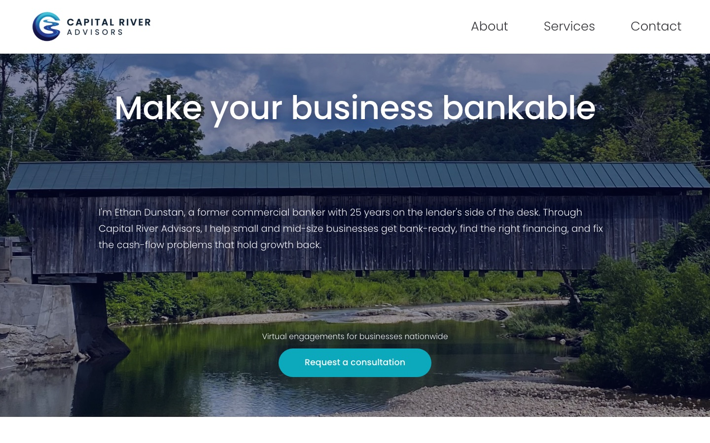
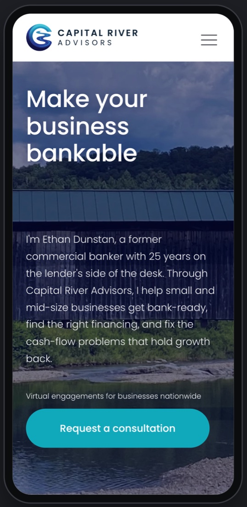
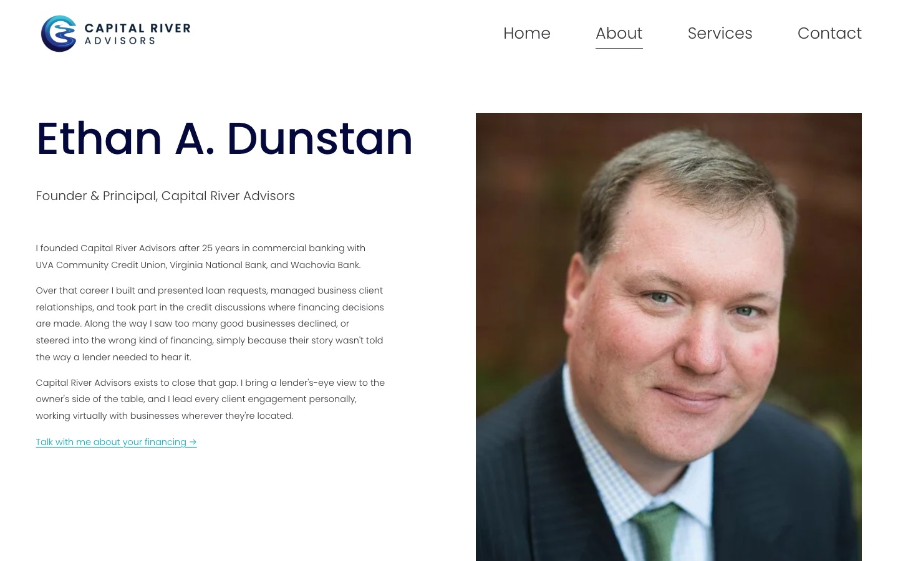
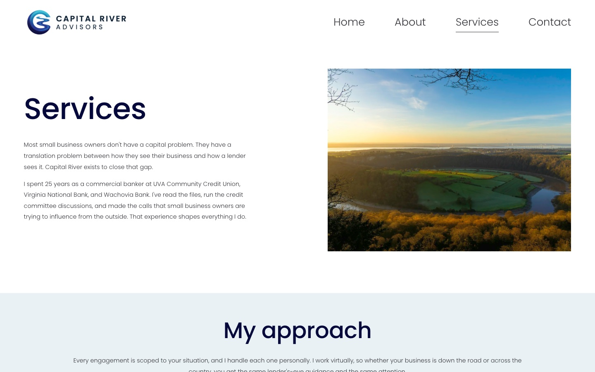

# Capital River Advisors: Website

**🌐 Live site: [capitalriveradvisors.com](https://www.capitalriveradvisors.com)**

Capital River Advisors helps small and mid-size businesses get bank-ready, find the right financing, and fix the cash-flow problems that hold growth back. It's run by Ethan Dunstan, a former commercial banker with 25 years on the lender's side of the desk.

This repository holds the redesigned company website.

---

## What's in the redesign

- **A homepage built around the covered bridge.** The headline sits in the sky, the introduction sits on the bridge, and the call to action sits over the river. The text stays lined up with the photo on every screen size, from phones to wide desktop monitors.
- **Clearer pages.** About, Services and Contact were tightened up: consistent colours, room to breathe, and one key message per section. Examples are "I'm not a broker" on Services and a short "How it works" on the homepage.
- **Made for phones.** Every page was reviewed and adjusted at phone size, both upright and sideways.
- **Room to grow.** The testimonial area becomes a gently rotating carousel as soon as more client testimonials are added.

<table>
  <tr>
    <td width="32%"></td>
    <td>  </td>
  </tr>
  <tr>
    <td align="center">Homepage on a phone</td>
    <td align="center">About and Services</td>
  </tr>
</table>

---

## How it was made

The site started as a copy of the original Squarespace site. It was then reshaped over many quick review rounds. The owner clicked on anything they wanted changed, left a typed or spoken note, and each round of notes was applied and checked on desktop and phone sizes.

The finished design is still hosted on **Squarespace**, so the existing forms, analytics and domain all keep working. This repository is the master copy of the design, and every published version is saved here so any change can be rolled back.

## Repository at a glance

| Folder | What it holds |
|---|---|
| `CapRiver/` | The website itself |
| `squarespace/` | The tool that prepares the site for Squarespace |
| `dev/` | Tools used only while designing (preview server, click-to-comment, phone preview) |
| `advice.md` | Detailed notes for anyone continuing the work |

---

*Questions about the business? Visit the [contact page](https://www.capitalriveradvisors.com/contact).*
